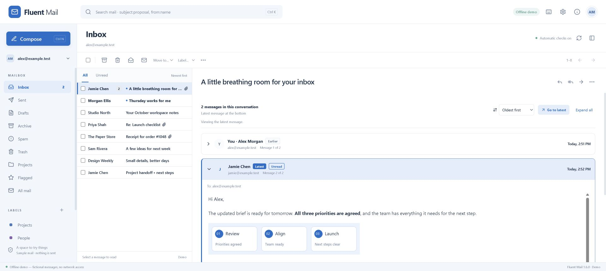

# Fluent Mail

A standalone Windows client for Zoho Mail, built for a familiar three-pane workflow. Independent software, not an official Zoho application.

## Run

[Download the Windows executable from GitHub Releases](https://github.com/safetyfluent/FluentMail/releases/latest). Open the downloaded file; Node.js is not required. On the development PC, the full path is **`C:\Projects\SafetyFluent\Zoho Mail\release\Fluent-Mail-1.6.0-Windows-x64.exe`**. The unpacked alternative is `C:\Projects\SafetyFluent\Zoho Mail\release\win-unpacked\Fluent Mail.exe` (keep that entire directory together).

v1.6 makes conversation order explicit: newest first by default, an optional remembered oldest-first order, Latest/Earlier/Unread labels, sequence numbers, clear timestamps and Go to latest. Earlier-message replies remain tied to the selected message. [Research and decisions](docs/CONVERSATION-UX.md).



v1.5 adds conversation chains with message-count badges and safe received inline images. It also includes two-character recipient suggestions, Send now during the countdown, Del-to-Trash, single-line rows and optional SMTP sending for inline images. History and credentials stay encrypted and separate for every mailbox. See [the image investigation and resolution](docs/INLINE-IMAGES.md).

### Send pasted images inside the message

1. Connect the mailbox using its saved API connection.
2. Open **Settings → Inline images (SMTP)** and select that mailbox.
3. For a free organization, keep **Standard / free organization**. Enter its Zoho app password if two-factor authentication is on, or mailbox password if it is off. This is not the OAuth client secret. Click **Save SMTP password**.
4. **Check SMTP connection** verifies sign-in without sending mail. A rejection pauses SMTP for review; it does not retry or change the subscription.
5. Resume the draft, paste the image and click Send. The five-second timer and Send now/Cancel work normally. Images are embedded once in the body. Explicitly attached documents remain ordinary attachments.

The SMTP password is stored only in the Windows-encrypted settings vault. Receiving and non-image sends keep using the API. Zoho normally saves SMTP messages in Sent automatically. Inline-image messages currently send immediately and their drafts stay on this PC; server scheduling and cloud draft copies remain available for supported API messages. SMTP availability depends on the actual account configuration. No real SMTP sign-in is claimed merely because an offline MIME test passed.

Exit the old version before opening the new executable. Existing Windows-encrypted accounts and drafts are retained. The original v1.0 portable executable is kept as a separate file. Open **About Fluent Mail** to confirm the running version and creator information: Martin Miles, SafetyFluent, martin@safetyfluent.com.

The app starts disconnected. **Explore with sample mail** opens a completely offline demo. The demo uses fictional `example.test` mailboxes; it cannot send real email. Use the tray menu's **Exit Fluent Mail**, then restart normally to leave demo mode.

The build is unsigned. No certificate or auto-update service has been configured. Source, tests, lockfile and build scripts are provided for reproducibility.

### Staying active and receiving mail

After connecting, automatic Inbox checks run in the desktop process, including while the window is hidden. Default interval: **15 seconds after the preceding sweep completes**. Requests are paced across accounts, so arrival latency can be longer; this is automatic polling, not instantaneous push. Settings lets you change the interval, pause checks, enable desktop notifications, control previews/sound, and request a test notification.

Closing or minimizing hides the window to the **system tray beside the Windows clock**. Click the tray envelope to reopen. **Right-click → Exit Fluent Mail** saves the current draft and exits; an in-progress send must finish first. The tray also offers Check now, Pause/resume checks, and About. A marked tray icon indicates new arrivals since you last focused the app.

The first check silently establishes the mailbox baseline. Later new unread arrivals can produce grouped Windows notifications. Clicking an alert restores the source mailbox/message. Native notifications honor Windows Do Not Disturb and notification settings. The portable app creates/updates its own Start Menu shortcut with notification identity on normal packaged launch; demo mode does not register a shortcut. No Windows login auto-start is installed.

## Multiple mailboxes and businesses

- Add each independent Zoho authorization in **Settings → Add a Zoho account**. All mailbox accounts returned by that authorization are listed.
- A Zoho organization administrator is not automatically authorized to read each employee's mailbox. Separate login identities require separate owner-authorized OAuth grants, even when they share a domain.
- Different businesses, domains, free accounts and supported Zoho data centers can coexist in the same application. The credential and mailbox identities remain separate.
- The mailbox picker opens an individual mailbox or **All inboxes**. The unified view shows up to the latest 40 messages from each connected Inbox, sorted together. Open an individual mailbox for complete pagination and folder/label management. Searches in the unified view query each connected mailbox.
- Every unified message identifies its source mailbox. Reply/reply-all use that mailbox automatically, honor Reply-To, and preserve the original message reference. New messages ask which mailbox to send from. Only aliases returned for that mailbox are offered as From addresses.
- Bulk selection is restricted to one source mailbox at a time. This prevents ambiguous cross-business folder and label operations.

## Connect a mailbox

Use the official [Zoho Self Client instructions](https://www.zoho.com/developer/oauth/self-client/overview.html). This is a one-time personal application setup, not an IMAP/SMTP workaround or a mailbox-password login.

1. Sign in yourself to your region's Zoho API Console, using the identity that owns the mailbox.
2. Create a **Self Client**. Keep its Client ID and Client Secret private.
3. Generate a fresh authorization code with the scopes displayed below and in the application's connection instructions. Select a validity period that gives you time to complete the form.
4. In Fluent Mail Settings, enter the expected mailbox address, data center, Client ID, Client Secret and code. Select **Connect new account** once.
5. The application exchanges that code and checks that the authenticated mailbox matches the address entered. Success closes Settings, selects the mailbox and shows a confirmation while its Inbox loads. Failure keeps an error visible. Other identities must be connected individually.

```text
ZohoMail.accounts.READ,ZohoMail.folders.READ,ZohoMail.folders.CREATE,ZohoMail.folders.UPDATE,ZohoMail.tags.READ,ZohoMail.tags.CREATE,ZohoMail.messages.READ,ZohoMail.messages.CREATE,ZohoMail.messages.UPDATE
```

These are mailbox scopes, not organization-administrator scopes. Alias addresses do not create separate inboxes.

**Owner-reported live result:** on 2026-10-28 the owner confirmed that v1.0 connected and successfully delivered an attachment to an external mailbox. The assistant did not perform or observe those tests. The new background checking, token renewal, rich HTML and Windows notification behavior have been tested with offline fixtures, not production mailboxes.

## Conversations and received images

The circular badge beside a sender shows the conversation message count. A + marks a lower bound from recent Inbox/Sent summaries; opening the full conversation resolves its count. The newest message opens first, including cross-folder replies. **Conversation order** chooses newest first or oldest first and remembers the choice locally. The **Latest** label always identifies the newest message; **Unread** is a separate status. **Message N of M** follows chronological sequence in either order and appears only for complete, dated history.

Click an older header or **Expand all** to read history. A notice identifies an earlier message as the current reply target. **Go to latest** returns to the newest card without losing the chosen order or downloading cached content again; **Collapse earlier messages** reduces the stack. A newly arriving reply updates the Latest label while preserving an earlier message you are already reading. **Load older messages** retrieves another bounded page of long history. Reply buttons under each card reply to that exact message. Delete and move remain message operations.

Embedded raster images display in the body without enabling remote tracking images. Unsupported, missing or oversized embedded parts show a warning. No new authorization code or scope is needed for these features.

## Everyday use

- Search accepts Zoho search syntax, for example `subject:proposal` or `from:someone@example.com`. Press Enter to search; typing does not issue requests.
- Opening a message reads its content; use the toolbar to explicitly mark it read/unread.
- Archive, flags, spam/not-spam, labels and moves operate on the selected messages. Trash is a move, not permanent deletion. Permanent delete/empty-folder commands are intentionally absent.
- Compose now uses a WYSIWYG HTML editor with formatting, fonts/sizes, colors, lists, alignment, quotes, safe links, emoji and undo/redo. Use To recipient chips and the Cc/Bcc controls, authorized From addresses, reply/reply-all, forwarding, file attachments, formatted signatures and Zoho's 1/2/4-hour delayed-send presets. Ctrl+Enter starts the same five-second send countdown; the maximize control provides more editing space. Older plain-text drafts are converted safely when opened.
- **Send** starts a five-second countdown for a valid supported message. **Send now** submits immediately; **Cancel send** returns to editing. No uploads or send request begin until expiry or Send now. Closing the composer or explicitly exiting during the countdown cancels the pending submission and preserves the draft. A successful API response means Zoho accepted the operation, not that every recipient received it.
- **Paste images/files:** Ctrl+V in the editor inserts clipboard raster images directly into the body. Files copied in Windows Explorer become attachments. Text and formatted text still paste normally. Clipboard data is read only for the paste action; no clipboard history or monitoring is used. PNG/JPEG/GIF/WebP images are supported; SVG is not embedded. Network file paths must be copied locally first. Inline images are stored in the encrypted local draft; ordinary clipboard-file handles must be reattached after restarting, like other session attachment handles.
- Pasted images stay in encrypted local drafts and use the selected mailbox's configured SMTP connection when sent. They do not become ordinary image-file copies. Images require per-mailbox setup; cloud image drafts and scheduling are disabled rather than silently dropping images. Unsupported server-image references are removed from quoted replies. The reader still blocks remote images.
- Local drafts are encrypted and stored separately per authorization/mailbox/draft. Compose lets you resume saved drafts or start another. Closing a composer preserves it; Discard removes only that local draft.
- **Save copy to Zoho Drafts** creates a new cloud draft. It does not silently overwrite an existing server draft. Opening a cloud draft uses **Edit as new message**; the original stays in Zoho.
- Attachments stay local until send/cloud-save. The client caps uploads at 20 MB total and downloads at 30 MB. Files must be reattached after restarting. Forwarding and editing-as-new do not automatically copy the original attachments; download and reattach the ones you want.
- Remote images, embedded forms, scripts, unsafe URLs and active content are removed from displayed messages. Safe text formatting is preserved. Web links are listed separately and require confirmation before opening in your browser. Embedded PNG/JPEG/GIF/WebP images are downloaded through authenticated Zoho APIs and displayed safely. Arbitrary CSS layouts are not reproduced. Pasted and outgoing rich HTML are independently sanitized.
- Automatic checks run for connected accounts. Healthy expiring OAuth tokens renew once through the shared rate limiter. Accounts start disconnected on launch and do not automatically reconnect after a rejected or uncertain request. There is no telemetry or Windows login auto-start.

## Keyboard shortcuts

| Shortcut                 | Action                                |
| ------------------------ | ------------------------------------- |
| Ctrl+N                   | Choose a sending mailbox / compose    |
| Ctrl+K                   | Focus search                          |
| Ctrl+K in the editor     | Insert/edit a link                    |
| Ctrl+Enter in compose    | Send with a five-second cancel window |
| Ctrl+B / Ctrl+I / Ctrl+U | Bold / italic / underline             |
| Up / Down                | Browse the message list               |
| R                        | Reply                                 |
| F5                       | Refresh the current view              |
| Escape                   | Clear selection or close a dialog     |

## Data and account safety

OAuth credentials and local drafts are stored in `%APPDATA%\SafetyFluent\Fluent Mail\settings.vault`, encrypted using Electron `safeStorage` and Windows user protection. There is no plaintext fallback. Access tokens never reach the renderer. Saved accounts remain disconnected on startup. Demo launches with `--demo` use isolated storage and never instantiate the live service.

Network, authentication, permission, rate-limit and unexpected-response failures stop the affected connection and background checks for that profile. There is no automatic retry. Normal proactive OAuth renewal while connected is distinct from retrying rejected authentication. Sends are recorded as pending before the final request; uncertain sends cannot be repeated from the same draft, even after a restart. Check Zoho's Sent folder before deliberately creating another message. Review any account restriction with the owner before reconnecting.

For an assistant-led live check, follow `docs/PLAN-1.1.md` and PROJECT_CONTEXT.md: explicit owner approval for one named mailbox, this Windows client/device, a bounded connection attempt and owner availability. Disable automatic checks before a connection-only test, and disconnect afterward; testing background checks requires an approved duration and stop condition. Mail sending requires a separately specified recipient and content. A previous login or saved token is not testing authorization.

## Develop and test

```powershell
npm ci
npm run check
npm test
npm run build
npm run demo
npm run package
```

`npm run dev` serves a **demo-only** renderer at `http://127.0.0.1:5187`. It has no live backend or credentials. `npm run smoke` launches the desktop shell hidden in isolated demo mode, checks that the renderer/preload work and Node is not exposed, then exits. To write its small non-sensitive result, set `FLUENT_SMOKE_RESULT` to a local output path before running it.

See [API coverage](docs/API-COVERAGE.md), [test report](docs/TEST-REPORT.md), and [project context](PROJECT_CONTEXT.md). Read `PROJECT_CONTEXT.md` first on every future visit to this project.
